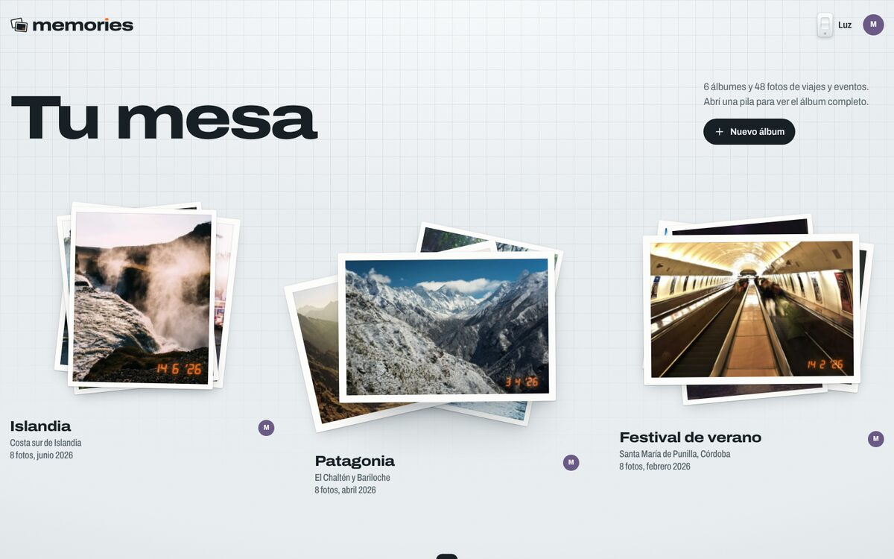
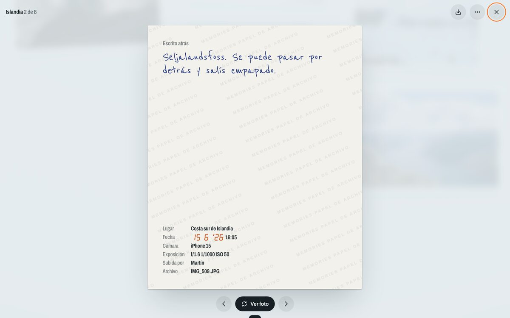
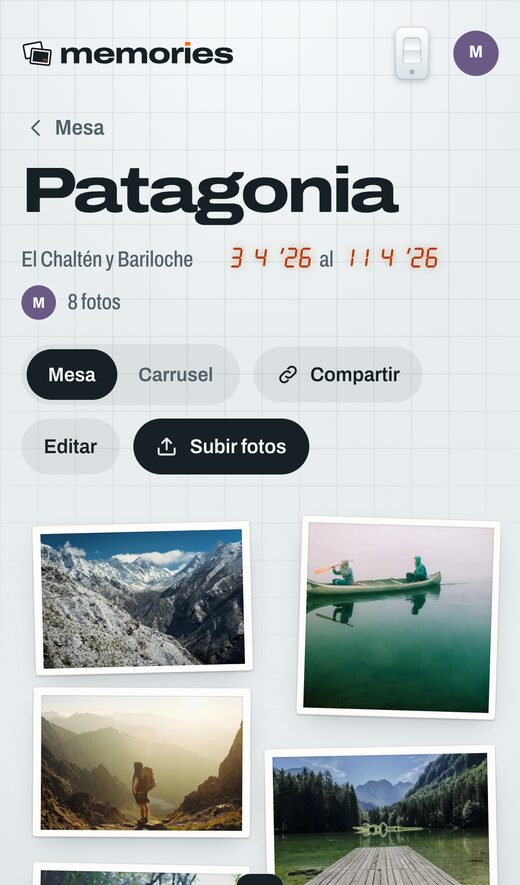
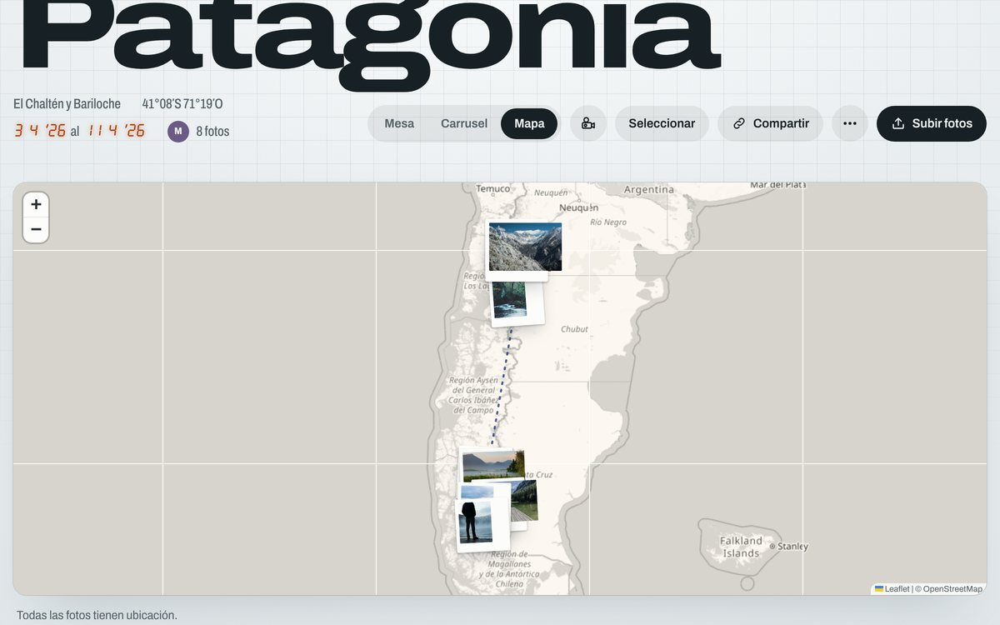
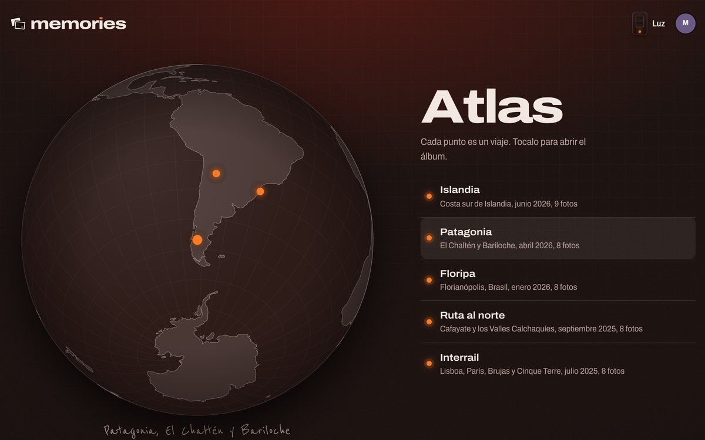
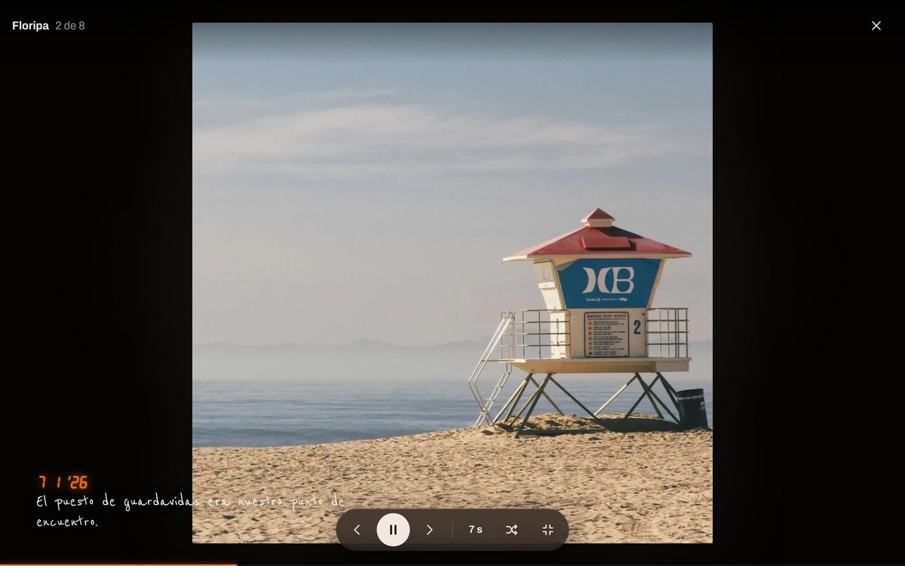

<p align="center">
  <picture>
    <source media="(prefers-color-scheme: dark)" srcset="brand/memories-logo-dark.svg">
    
  </picture>
</p>

<p align="center">Tus fotos de viajes y eventos en un lugar propio.<br>Open source, self-hosted, y pensado para la compu y el celu.</p>



Memories junta las fotos de un viaje, un recital o un cumpleaños en un álbum que comparten todos los que estuvieron. Cada uno sube las suyas desde el celu o la compu, y el álbum queda en tu servidor, no en la nube de otro.

La interfaz imita los objetos reales de la fotografía. Los álbumes son pilas de copias sobre una mesa de luz y las fotos se pueden arrastrar, levantar y dar vuelta: en el dorso está lo que escribieron y los datos de la cámara. Al subir una foto, se **revela** como en la cubeta del laboratorio. Si apagás la luz, entrás al cuarto oscuro.

| | |
|---|---|
|  |  |



## Qué hace

- **Álbumes compartidos**: invitás con un link y cada persona sube sus fotos al mismo álbum.
- **Links públicos** de solo lectura, con contraseña opcional y permiso para descargar originales.
- **Subida desde el celu o la compu**: arrastrás las fotos o las elegís. Acepta JPG, PNG, WebP y HEIC de iPhone.
- **Lee el EXIF** para ordenar por fecha y completar el dorso con la cámara, la exposición y la hora. Las versiones que se muestran no llevan el EXIF, así que tampoco la ubicación GPS.
- **Notas escritas atrás** de cada foto.
- **Dos vistas**: la mesa, con copias que se arrastran con inercia, y el carrusel de diapositivas en 3D.
- **Tema claro (mesa de luz) y oscuro (cuarto oscuro)**, con navegación por teclado y respeto por `prefers-reduced-motion`.
- **Tus archivos son tuyos**: los originales se guardan tal cual, en una carpeta que podés respaldar como quieras.

- **Editar**: fecha, hora, lugar y cámara desde el dorso; corregir la hora de muchas fotos juntas; girar y ordenar a mano.
- **Ver**: álbum por días, favoritas, "hace un año", **mapa** del álbum y **Atlas** (globo con todos tus viajes), y **modo proyector**.
- **Personas**: decí quién aparece en cada foto. Con el **reconocimiento facial** prendido (panel de admin) Memories agrupa caras parecidas, todo dentro de tu servidor (YuNet + SFace; la primera vez descarga ~40 MB de modelos).
- **Compartir**: subir sin cuenta con link y QR, descargar en ZIP, comentarios, reacciones y avisos por mail (SMTP).
- **App para el celu (PWA)**: se instala sin tiendas, guarda lo que ya viste para mirarlo sin conexión y aparece en el menú Compartir de la galería. **Necesita HTTPS** (por ejemplo Caddy con un dominio propio, o `tailscale serve`); por `http://` el navegador no deja instalarla.
- Las fotos sin EXIF (por ejemplo de WhatsApp) toman la fecha del archivo: se arreglan con "Corregir la hora".

| | |
|---|---|
|  |  |



<br clear="right">

## Instalar en Proxmox (CT)

En la consola del host de Proxmox:

```bash
bash -c "$(curl -fsSL https://raw.githubusercontent.com/MartinLautaroGimenez/memories/HEAD/scripts/proxmox-ct.sh)"
```

El script hace todo esto:

1. Crea un CT Debian 12 sin privilegios (2 núcleos, 2 GB de RAM, 32 GB de disco y DHCP).
2. Instala Node.js 22 y PostgreSQL adentro.
3. Compila Memories y lo deja como servicio que arranca solo.

Al terminar te muestra la dirección, por ejemplo `http://192.168.1.50:3000`. Abrila y creá la primera cuenta.

Para cambiar los valores, ponelos delante del comando:

```bash
CT_DISK=200 CT_RAM=4096 CT_IP=192.168.1.50/24 CT_GW=192.168.1.1 MEMORIES_URL=https://fotos.tudominio.com bash -c "$(curl -fsSL https://raw.githubusercontent.com/MartinLautaroGimenez/memories/HEAD/scripts/proxmox-ct.sh)"
```

Todas las opciones están al principio de [`scripts/proxmox-ct.sh`](scripts/proxmox-ct.sh). Si ya tenés un CT con Debian o Ubuntu, o cualquier máquina con esos sistemas, corré este comando adentro:

```bash
bash -c "$(curl -fsSL https://raw.githubusercontent.com/MartinLautaroGimenez/memories/HEAD/scripts/install.sh)"
```

Para **actualizar**, corré esto desde el host. Las fotos, la base de datos y la configuración se conservan.

```bash
pct exec <CTID> -- memories-update
```

### Entrar con un nombre en vez de la IP

Si tu router tiene DNS local (por ejemplo `fotos.casa.lan` apuntando a la IP del CT), corré esto desde el host para entrar por ese nombre y sin puerto:

```bash
pct exec <CTID> -- env MEMORIES_URL=http://fotos.casa.lan MEMORIES_PORT=80 memories-update
```

También se puede seguir entrando por la IP. Evitá los nombres terminados en `.local`: están reservados para mDNS y algunos celulares, sobre todo los iPhone, no los resuelven por el DNS del router. Usá `.lan`, `.home.arpa` o `.internal`.

Las fotos quedan en `/var/lib/memories/photos`, la configuración en `/etc/memories/memories.env` y los logs se ven con `journalctl -u memories -f`.

## Instalar con Docker

Necesitás Docker con Compose.

```bash
git clone https://github.com/MartinLautaroGimenez/memories.git
```

```bash
cd memories && cp .env.example .env
```

Editá `.env`. Como mínimo poné `APP_URL` (la dirección con la que vas a entrar, por ejemplo `https://fotos.tudominio.com`) y un `AUTH_SECRET` largo y aleatorio, que podés generar con:

```bash
openssl rand -base64 32
```

Después levantalo:

```bash
docker compose up -d
```

Abrí `APP_URL` y creá la primera cuenta, que administra la instalación. De ahí en más, la gente entra con las invitaciones de cada álbum.

Las fotos quedan en el volumen `photos` y la base de datos en `db`. Para tener las fotos en una carpeta tuya, cambiá `photos:/data` por `./fotos:/data` en `docker-compose.yml`. La carpeta tiene que pertenecer al usuario 1000.

Si lo publicás en internet, ponelo detrás de un proxy con HTTPS (Caddy, Traefik, nginx) y usá `https://` en `APP_URL`.

### Configuración

| Variable | Para qué | Por defecto |
|---|---|---|
| `APP_URL` | Dirección pública. Se usa en los links compartidos y para validar los formularios | `http://localhost:3000` |
| `AUTH_SECRET` | Firma sesiones y links. **Obligatoria** en producción | — |
| `DATABASE_URL` | Conexión a PostgreSQL | la del compose |
| `TRUSTED_ORIGINS` | Otras direcciones desde las que se entra, separadas por coma (por ejemplo la IP local) | — |
| `STORAGE_PATH` | Dónde se guardan las fotos | `/data` en Docker |
| `MAX_UPLOAD_MB` | Tamaño máximo por foto | `200` |
| `PROCESS_CONCURRENCY` | Fotos que se procesan en paralelo | `2` |

## Desarrollo

Necesitás Node 22, pnpm 10 y PostgreSQL 16.

```bash
pnpm install
```

```bash
cp .env.example .env
```

```bash
pnpm dev
```

Las migraciones se aplican solas al arrancar. Para ver la interfaz con contenido, creá tu cuenta en http://localhost:3000 y cargá los álbumes de ejemplo:

```bash
./design/prototype/fetch-photos.sh
```

```bash
node scripts/seed-demo.mjs http://localhost:3000 tu@email.com tu-contraseña
```

| Comando | Qué hace |
|---|---|
| `pnpm lint`, `pnpm typecheck` | ESLint y TypeScript |
| `pnpm test` | Pruebas unitarias (pipeline de fotos, incluido HEIC) |
| `pnpm test:e2e` | Pruebas de punta a punta con Playwright contra una app corriendo con la base vacía |
| `pnpm db:generate` | Genera una migración nueva después de cambiar `src/server/db/schema.ts` |
| `pnpm brand` | Regenera el logo y los íconos desde `brand/src` |

### Cómo está armado

| Ruta | Qué hay |
|---|---|
| `src/app` | Páginas y rutas de Next.js: la mesa, los álbumes, el acceso, la API y `/media` (sirve las fotos con control de acceso) |
| `src/components` | La interfaz: pilas, mesa, carrusel, visor, subida y compartir |
| `src/server` | Base de datos (Drizzle), auth (Better Auth), storage, permisos y el procesamiento de fotos |
| `src/app/app.css` | El sistema visual completo, con tokens para los dos temas |
| `drizzle/` | Migraciones SQL |
| `brand/` | Logo, íconos y los scripts que los generan |
| `design/prototype/` | El prototipo HTML original, la referencia visual |
| `docs/DESIGN.md` | Producto, arquitectura y decisiones |
| `.claude/skills/` | El sistema de diseño escrito como skill, para trabajar con Claude Code |

Si vas a tocar la interfaz, leé primero [`.claude/skills/memories-ui/SKILL.md`](.claude/skills/memories-ui/SKILL.md).

## Licencia

[AGPL-3.0](LICENSE). Podés usarlo, modificarlo y ofrecerlo como servicio, pero si lo ofrecés a otros con cambios, tenés que publicar esos cambios.

Usa Leaflet y teselas de © OpenStreetMap, d3-geo y world-atlas (ISC), ONNX Runtime (MIT) y los modelos YuNet (MIT) y SFace (Apache-2.0) de OpenCV Zoo.

Las tipografías Archivo y Reenie Beanie se distribuyen con licencia SIL Open Font License. Las fotos de las capturas y del prototipo son de [Unsplash](https://unsplash.com) (ver [créditos](design/prototype/CREDITS.md)), y los textos y personas de los álbumes de ejemplo son inventados.
