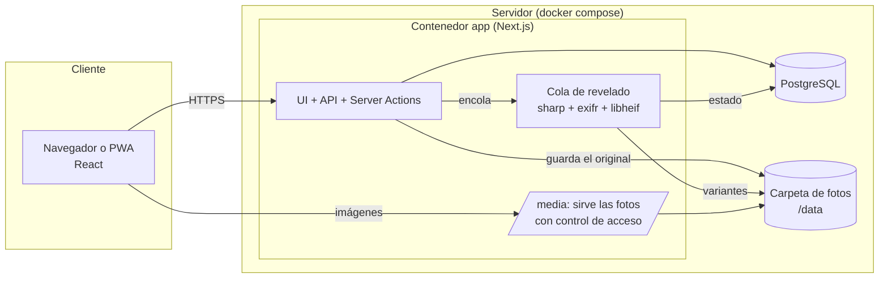

# Memories: documento de diseño

Estado: borrador para discutir. Última revisión: noviembre de 2026.

## 1. Qué es

Memories es un lugar propio para guardar las fotos de tus viajes, recitales, cumpleaños y cualquier evento, y verlas desde la compu o el celular. Es **open source y self-hosted**: cada persona (o familia, o grupo de amigos) lo levanta en su servidor, NAS o VPS con Docker, y las fotos quedan en su disco.

No intenta reemplazar a Google Fotos ni a Immich, que ya resuelven el backup automático de todo el carrete. Memories se ocupa de otra cosa: **los álbumes que querés volver a mirar y compartir**. Por eso cada álbum es un viaje o un evento, con su lugar, sus fechas y la gente que estuvo.

### Para quién

- La persona que vuelve de un viaje y quiere juntar las fotos de todos en un solo lugar.
- El grupo de amigos que fue a un festival y cada uno sacó 200 fotos con su celular.
- La familia que quiere un archivo privado, sin depender de una nube ajena.
- Quien sabe levantar un `docker compose up` (o tiene a alguien que sí).

### Qué lo hace distinto

1. **Álbumes colaborativos de verdad**: todos los que estuvieron suben sus fotos al mismo álbum, sin mandarse links de Drive.
2. **Una interfaz que se siente física**: las fotos son copias de papel sobre una mesa de luz. Se apilan, se arrastran, se dan vuelta y en el dorso está lo que escribiste y los datos de la cámara (ver la sección 4).
3. **Liviano y propio**: un contenedor para la app y otro para Postgres. No hace falta GPU ni servicios externos.

## 2. Alcance

### MVP (v0.1)

- Cuentas con email y contraseña. La primera persona que entra es la administradora de la instancia.
- Crear álbumes con título, lugar, coordenadas opcionales y fechas que se calculan solas a partir de las fotos.
- Subir fotos arrastrando, con el selector de archivos o desde el celu. JPG, PNG, WebP y HEIC. Se procesan en segundo plano.
- Leer el EXIF (fecha, cámara, exposición y GPS) para ordenar y completar el dorso.
- Vistas del álbum: **Mesa** (copias sueltas que se pueden arrastrar) y **Carrusel** (diapositivas en 3D). El visor permite dar vuelta la foto.
- Notas escritas en el dorso de cada foto.
- Miembros del álbum con roles: administra, puede subir o solo mira.
- Links públicos de solo lectura, con contraseña y vencimiento opcionales.
- Descargar el álbum completo en un ZIP.
- PWA instalable en el celu.
- Temas Mesa de luz (claro) y Cuarto oscuro (oscuro).
- Español e inglés.

### Después del MVP

- "Hace un año": una foto que vuelve a aparecer en la mesa.
- **Share target** de la PWA: desde la galería del celu, Compartir → Memories → elegir álbum.
- Videos cortos (los "Live Photos" y clips de menos de 30 segundos).
- Atlas: un mapa o globo con los lugares de cada álbum.
- Login con OIDC (Authentik, Authelia, Keycloak) para quienes ya tienen SSO en casa.
- Comentarios y reacciones en las fotos.
- Detección de duplicados cuando dos personas suben la misma foto.
- Importar desde Google Takeout.

### Fuera de alcance (por ahora)

- Backup automático de todo el carrete del celu.
- Reconocimiento facial o búsqueda con IA.
- Edición de fotos.

## 3. Arquitectura



### Stack (lo que quedó implementado)

| Capa | Elección | Por qué |
|---|---|---|
| Framework | **Next.js 16** (App Router) + **React 19** + **TypeScript** | UI y API en un solo proyecto y un solo contenedor (`output: standalone`). |
| UI | CSS propio con tokens en `src/app/app.css`, sin framework de estilos | El sistema visual es muy específico (copias, mesa, dorso). Los tokens ya resuelven los dos temas y un framework no aportaba. |
| Animación | **Web Animations API** + CSS 3D, sin librerías | El FLIP pila → álbum, el revelado, el volteo y la inercia se resuelven con `element.animate()` y `transform`. No suma peso al bundle. |
| 3D pesado | **React Three Fiber**, solo si llega el Atlas | Se cargaría con `dynamic()` en su propia ruta. |
| Base de datos | **PostgreSQL 16** + **Drizzle ORM** (driver `pg`) | Tipado de punta a punta. Las migraciones se aplican solas al arrancar. |
| Cola de trabajos | **En el mismo proceso**, respaldada por la tabla `photo` | Lo que queda en `processing` se retoma al reiniciar, con hasta 3 intentos. Para una app self-hosted de un contenedor alcanza, y es un servicio y una dependencia menos. |
| Imágenes | **sharp** (libvips), **exifr** y **heic-decode** (libheif en WASM) | sharp no trae HEVC por patentes. El HEIC de iPhone se decodifica con libheif y después pasa por sharp. |
| Auth | **Better Auth** (email y contraseña) | Sesiones en Postgres. OIDC queda para después. |
| Storage | Disco local (`STORAGE_PATH`) | Los originales quedan tal cual en una carpeta que podés respaldar. S3 queda para después. |
| Tests | Vitest + Playwright | Unitarios para el pipeline (con HEIC) y de punta a punta para subir, revelar, dar vuelta, compartir e invitar. |

### Pipeline de una foto

1. El cliente sube cada archivo con `POST /api/albums/:id/photos`, con el cuerpo crudo (sin multipart) y el nombre en `x-file-name`. Sube de a tres en paralelo. El servidor lo guarda en streaming, cortando si supera `MAX_UPLOAD_MB`.
2. Se crea la fila `photo` con `status = processing` y se encola.
3. La cola:
   - Lee el EXIF: fecha (como hora de reloj de la cámara), cámara, exposición y GPS.
   - Genera dos variantes en WebP, rotadas según el EXIF y **sin metadatos**: `thumb` (720px) y `display` (1800px).
   - Calcula el color dominante y un **thumbhash**, que es la "imagen latente" que se ve mientras carga la real.
4. La foto pasa a `ready`. El cliente, que consulta el estado cada 1,5 segundos, la "revela".

Mientras tanto, la copia muestra la vista previa local del archivo como imagen latente (blanca, sin contraste y desenfocada).

El original **nunca se modifica**: se guarda tal cual y es lo que baja con "Descargar originales".

### Modelo de datos

El esquema completo está en `src/server/db/schema.ts`.

```
user, session, account, verification   tablas de Better Auth (+ user.role: admin | member)
album         id, slug, title, place, lat, lng, cover_photo_id, created_by, created_at
album_member  album_id, user_id, role (owner | contributor | viewer)
photo         id, album_id, uploaded_by, original_key, original_name, mime, bytes,
              width, height, taken_at, lat, lng, camera, exposure (jsonb),
              color, thumbhash, variants (jsonb), note, status, attempts, error
share_link    id, album_id, token, password_hash, allow_download, expires_at, revoked_at
invite        id, album_id, token, role, expires_at (14 días), uses, revoked_at
```

Las fechas del álbum (desde y hasta) se calculan a partir de sus fotos. Los permisos son estos:

- **owner**: administra el álbum, comparte, elige la portada y borra cualquier foto.
- **contributor**: sube fotos, escribe notas y borra las fotos que subió.
- **viewer**: solo mira.

### Despliegue

Son dos contenedores: `app` (imagen de unos 420 MB, usuario sin privilegios uid 1000, con healthcheck en `/api/health`) y `db` (Postgres 16). Están en [`docker-compose.yml`](../docker-compose.yml) y las instrucciones en el [README](../README.md#instalar-con-docker).

La CI (`.github/workflows/ci.yml`) corre lint, tipos y pruebas unitarias, y después las pruebas de punta a punta contra Postgres y el build standalone. También compila la imagen. En `main` y en las versiones (`v*`) la publica en `ghcr.io` para amd64 y arm64, para que corra en una Raspberry Pi o un NAS.

## 4. Diseño visual

Concepto completo, tokens y reglas en [`.claude/skills/memories-ui/SKILL.md`](../.claude/skills/memories-ui/SKILL.md). Prototipo navegable en [`design/prototype/`](../design/prototype/).

**La idea**: la interfaz imita los objetos reales de la fotografía, como la copia en papel, la diapositiva, el fechador naranja de las cámaras compactas, la mesa de luz y el cuarto oscuro. Así se evita la estética genérica de las apps generadas con IA (todo tarjetas redondeadas, degradados violetas, Inter). Cada efecto 3D tiene una razón física de ser.

| Pantalla | Qué pasa |
|---|---|
| Tu mesa (inicio) | Cada álbum es una **pila de copias** con la portada arriba y la fecha estampada en naranja. Al pasar el mouse, la pila se inclina hacia el puntero con un reflejo de papel brillante y las copias de abajo se abren en abanico. |
| Abrir un álbum | Las copias **vuelan** de la pila a su lugar en la mesa del álbum (FLIP) y el título se expande con el eje de ancho de la tipografía. |
| Vista Mesa | Las fotos quedan sueltas, levemente rotadas. Se pueden **arrastrar con inercia** (en el celu, manteniendo presionado) y "Acomodar" las devuelve a su lugar. |
| Vista Carrusel | Un **anillo 3D de diapositivas** como el de un proyector. Se gira arrastrando, con las flechas o con el trackpad. |
| Visor | La copia se **levanta** de la mesa. Con "Dar vuelta" (o la tecla F) se ve el **dorso**: la nota a mano (editable), el lugar, la fecha, la cámara, la exposición y quién la subió. |
| Subir fotos | Se sueltan sobre la mesa y cada foto se **revela**: aparece blanca y la imagen emerge, como en la cubeta del laboratorio. |
| Tema | El interruptor **Luz** apaga la mesa y entra al **cuarto oscuro**, con luz de seguridad roja desde arriba. Al prender la luz, la mesa parpadea como un tubo fluorescente. |

Calidad mínima: funciona a 375px, se navega con teclado, respeta `prefers-reduced-motion` y anima solo `transform` y `opacity`.

## 5. Plan por etapas

| Etapa | Entregable |
|---|---|
| 0. Diseño | Este documento, el prototipo y la skill de diseño **(hecho)** |
| 1. Esqueleto | Next.js + TS, Drizzle + Postgres, Docker Compose y CI con lint, tests e imagen **(hecho)** |
| 2. Fotos | Subida en streaming, cola de revelado con sharp, exifr y HEIC, variantes, thumbhash y storage local **(hecho)** |
| 3. UI núcleo | Mesa con pilas, álbum con vistas Mesa y Carrusel, visor con dorso editable, tema Luz/Cuarto oscuro y logo **(hecho)** |
| 4. Personas | Cuentas, miembros con roles, invitaciones y links públicos con contraseña **(hecho)** |
| 5. Celu | PWA instalable y arrastre táctil **(hecho)**. Falta el share target (subir desde la galería) y probarlo en celulares reales |
| 6. v0.1 | Descargar el álbum en ZIP, i18n (inglés), "hace un año", primera release con imagen publicada |

## 6. Decisiones tomadas

- **Nombre**: Memories. Ya existe [Memories para Nextcloud](https://github.com/pulsejet/memories), pero es un plugin de Nextcloud y no una app independiente. El logo propio (copias apiladas con el fechador naranja) ayuda a diferenciarlo.
- **Licencia**: AGPL-3.0-only.
- **HEIC**: se decodifica con `heic-decode` (libheif compilado a WASM, licencia LGPL), así no hace falta un libvips especial en la imagen. Es más lento que una librería nativa, pero solo se usa con los HEIC.

## 7. Preguntas abiertas

1. **El idioma del código y la documentación.** Hoy el código (nombres de variables y funciones) está en inglés y los comentarios, la UI y la documentación en español rioplatense. ¿Pasamos el README a inglés para sumar contribuciones de afuera?
2. **El tamaño máximo de subida** (hoy 200 MB por foto) y si conviene permitir guardar solo las variantes para ahorrar disco.
3. **Las sesiones abiertas desde la red local.** Si se entra por IP y por dominio, hay que listar las dos en `TRUSTED_ORIGINS`. ¿Lo detectamos solo en la primera instalación?
