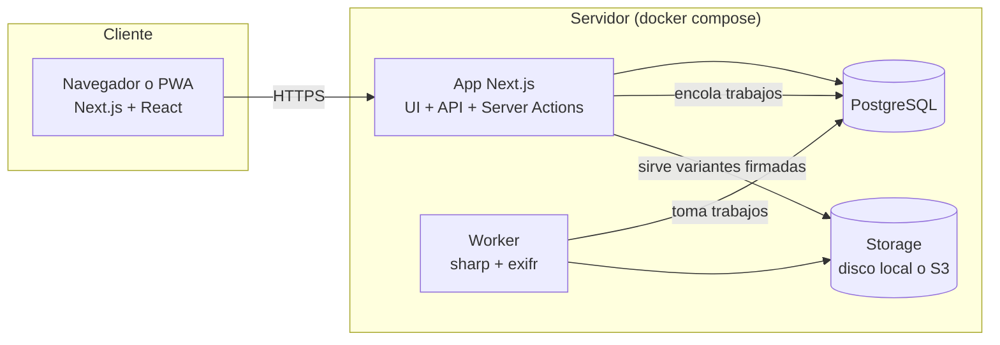

# Memories: documento de diseño

Estado: borrador para discutir. Última revisión: noviembre de 2026.

## 1. Qué es

Memories es un lugar propio para guardar las fotos de tus viajes, recitales, cumpleaños y cualquier evento, y verlas desde la compu o el celular. Es **open source y self-hosted**: cada persona (o familia, o grupo de amigos) lo levanta en su servidor, NAS o VPS con Docker, y las fotos quedan en su disco.

No intenta reemplazar a Google Fotos ni a Immich, que ya resuelven el backup automático de todo el carrete. Memories se ocupa de otra cosa: **los álbumes que querés volver a mirar y compartir**. Por eso cada álbum es un viaje o un evento, con su lugar, sus fechas y la gente que estuvo.

### Para quién

- La persona que vuelve de un viaje y quiere juntar las fotos de todos en un solo lugar.
- El grupo de amigos que fue a un festival y cada uno sacó 200 fotos con su celular.
- La familia que quiere un archivo privado, sin depender de una nube ajena.
- Quien sabe levantar un `docker compose up` (o tiene a alguien que sí).

### Qué lo hace distinto

1. **Álbumes colaborativos de verdad**: todos los que estuvieron suben sus fotos al mismo álbum, sin mandarse links de Drive.
2. **Una interfaz que se siente física**: las fotos son copias de papel sobre una mesa de luz. Se apilan, se arrastran, se dan vuelta y en el dorso está lo que escribiste y los datos de la cámara (ver la sección 4).
3. **Liviano y propio**: un contenedor para la app y otro para Postgres. No hace falta GPU ni servicios externos.

## 2. Alcance

### MVP (v0.1)

- Cuentas con email y contraseña. La primera persona que entra es la administradora de la instancia.
- Crear álbumes con título, lugar, coordenadas opcionales y fechas que se calculan solas a partir de las fotos.
- Subir fotos arrastrando, con el selector de archivos o desde el celu. JPG, PNG, WebP y HEIC. Se procesan en segundo plano.
- Leer el EXIF (fecha, cámara, exposición y GPS) para ordenar y completar el dorso.
- Vistas del álbum: **Mesa** (copias sueltas que se pueden arrastrar) y **Carrusel** (diapositivas en 3D). El visor permite dar vuelta la foto.
- Notas escritas en el dorso de cada foto.
- Miembros del álbum con roles: administra, puede subir o solo mira.
- Links públicos de solo lectura, con contraseña y vencimiento opcionales.
- Descargar el álbum completo en un ZIP.
- PWA instalable en el celu.
- Temas Mesa de luz (claro) y Cuarto oscuro (oscuro).
- Español e inglés.

### Después del MVP

- "Hace un año": una foto que vuelve a aparecer en la mesa.
- **Share target** de la PWA: desde la galería del celu, Compartir → Memories → elegir álbum.
- Videos cortos (los "Live Photos" y clips de menos de 30 segundos).
- Atlas: un mapa o globo con los lugares de cada álbum.
- Login con OIDC (Authentik, Authelia, Keycloak) para quienes ya tienen SSO en casa.
- Comentarios y reacciones en las fotos.
- Detección de duplicados cuando dos personas suben la misma foto.
- Importar desde Google Takeout.

### Fuera de alcance (por ahora)

- Backup automático de todo el carrete del celu.
- Reconocimiento facial o búsqueda con IA.
- Edición de fotos.

## 3. Arquitectura



### Stack

| Capa | Elección | Por qué |
|---|---|---|
| Framework | **Next.js** (App Router) + **TypeScript** | UI y API en un solo proyecto y un solo contenedor. Server Components para las vistas pesadas. |
| UI | React, CSS con tokens (variables) y **Tailwind v4** para utilidades | Los tokens del sistema de diseño viven en CSS y Tailwind los consume con `@theme`. |
| Animación | **Motion** (ex Framer Motion) para gestos y transiciones de layout; CSS 3D para las copias | Resortes, `layoutId` para el FLIP pila → álbum, y gestos con inercia. |
| 3D pesado | **React Three Fiber**, solo en vistas aisladas (el futuro Atlas) | Se carga con `dynamic()` y no entra en el bundle principal. |
| Base de datos | **PostgreSQL 16** + **Drizzle ORM** | Tipado de punta a punta y migraciones simples. |
| Cola de trabajos | **pg-boss** (sobre Postgres) | No suma Redis: un servicio menos para levantar. |
| Imágenes | **sharp** (libvips) con soporte HEIC, y **exifr** para los metadatos | Rápido, con poca memoria, y genera AVIF y WebP. |
| Auth | **Better Auth** | Email y contraseña desde el día uno y OIDC después, con sesiones en Postgres. |
| Storage | Adaptador propio: `local` (por defecto) o `s3` (MinIO, R2, B2, AWS) | Las fotos son archivos comunes en una carpeta que podés respaldar como quieras. |
| Tests | Vitest + Playwright | Unitarios para el pipeline y e2e para los flujos de subir, compartir y ver. |

### Pipeline de una foto

1. El cliente pide una URL de subida (`POST /api/uploads`) y sube el archivo original directo al storage, en partes si es grande.
2. Se crea la fila `photo` con `status = processing` y se encola `process-photo`.
3. El worker:
   - Lee el EXIF (fecha, cámara, exposición, GPS y orientación).
   - Genera tres variantes, `thumb` (480px), `display` (1600px) y `full` (2560px), en AVIF y WebP, rotadas según el EXIF.
   - Calcula el color dominante y un **thumbhash**. Son la "imagen sin revelar" que se ve mientras carga la real (ver Revelado en la sección 4).
   - Calcula un hash perceptual para detectar duplicados más adelante.
4. La foto pasa a `ready` y el cliente la "revela".

El original **nunca se modifica**: se guarda tal cual y es lo que baja con "Descargar originales".

### Modelo de datos (primera versión)

```
users            id, email, name, avatar_color, created_at
albums           id, slug, title, place, lat, lng, cover_photo_id,
                 starts_at, ends_at (calculadas), created_by, created_at
album_members    album_id, user_id, role ('owner' | 'contributor' | 'viewer')
photos           id, album_id, uploaded_by, storage_key, mime, bytes,
                 width, height, taken_at, lat, lng,
                 camera, exposure (jsonb), dominant_color, thumbhash,
                 phash, note, status, created_at
photo_variants   photo_id, kind ('thumb' | 'display' | 'full'), format, storage_key, width, height
share_links      id, album_id, token, password_hash, expires_at,
                 allow_download, created_by, created_at
invites          id, album_id, email, role, token, expires_at
```

### Despliegue

```yaml
# docker-compose.yml (borrador)
services:
  app:
    image: ghcr.io/<org>/memories:latest
    ports: ["3000:3000"]
    environment:
      DATABASE_URL: postgres://memories:memories@db:5432/memories
      STORAGE_DRIVER: local          # o s3
      STORAGE_PATH: /data/photos
      AUTH_SECRET: cambiame
    volumes: ["./photos:/data/photos"]
    depends_on: [db]
  worker:
    image: ghcr.io/<org>/memories:latest
    command: ["node", "worker.js"]
    environment: { DATABASE_URL: postgres://memories:memories@db:5432/memories, STORAGE_PATH: /data/photos }
    volumes: ["./photos:/data/photos"]
  db:
    image: postgres:16-alpine
    environment: { POSTGRES_USER: memories, POSTGRES_PASSWORD: memories, POSTGRES_DB: memories }
    volumes: ["./db:/var/lib/postgresql/data"]
```

App y worker usan la misma imagen y solo cambia el comando, así hay una sola cosa para construir y versionar.

## 4. Diseño visual

Concepto completo, tokens y reglas en [`.claude/skills/memories-ui/SKILL.md`](../.claude/skills/memories-ui/SKILL.md). Prototipo navegable en [`design/prototype/`](../design/prototype/).

**La idea**: la interfaz imita los objetos reales de la fotografía, como la copia en papel, la diapositiva, el fechador naranja de las cámaras compactas, la mesa de luz y el cuarto oscuro. Así se evita la estética genérica de las apps generadas con IA (todo tarjetas redondeadas, degradados violetas, Inter). Cada efecto 3D tiene una razón física de ser.

| Pantalla | Qué pasa |
|---|---|
| Tu mesa (inicio) | Cada álbum es una **pila de copias** con la portada arriba y la fecha estampada en naranja. Al pasar el mouse, la pila se inclina hacia el puntero con un reflejo de papel brillante y las copias de abajo se abren en abanico. |
| Abrir un álbum | Las copias **vuelan** de la pila a su lugar en la mesa del álbum (FLIP) y el título se expande con el eje de ancho de la tipografía. |
| Vista Mesa | Las fotos quedan sueltas, levemente rotadas. Se pueden **arrastrar con inercia** (en el celu, manteniendo presionado) y "Acomodar" las devuelve a su lugar. |
| Vista Carrusel | Un **anillo 3D de diapositivas** como el de un proyector. Se gira arrastrando, con las flechas o con el trackpad. |
| Visor | La copia se **levanta** de la mesa. Con "Dar vuelta" (o la tecla F) se ve el **dorso**: la nota a mano (editable), el lugar, la fecha, la cámara, la exposición y quién la subió. |
| Subir fotos | Se sueltan sobre la mesa y cada foto se **revela**: aparece blanca y la imagen emerge, como en la cubeta del laboratorio. |
| Tema | El interruptor **Luz** apaga la mesa y entra al **cuarto oscuro**, con luz de seguridad roja desde arriba. Al prender la luz, la mesa parpadea como un tubo fluorescente. |

Calidad mínima: funciona a 375px, se navega con teclado, respeta `prefers-reduced-motion` y anima solo `transform` y `opacity`.

## 5. Plan por etapas

| Etapa | Entregable |
|---|---|
| 0. Diseño | Este documento, el prototipo y la skill de diseño **(hecho)** |
| 1. Esqueleto | Repo Next.js + TS, Drizzle + Postgres, docker compose, CI con lint, tests y build de la imagen |
| 2. Fotos | Subida, worker con sharp y exifr, variantes, thumbhash y storage local |
| 3. UI núcleo | Mesa (inicio), álbum con vista Mesa, visor con dorso y tema Luz/Cuarto oscuro, portados del prototipo a componentes React |
| 4. Personas | Auth, miembros, invitaciones y links públicos |
| 5. Celu | PWA, gestos táctiles finos, subida desde la galería |
| 6. v0.1 | Carrusel, ZIP, i18n, documentación de instalación y primera release |

## 6. Preguntas abiertas

1. **El nombre.** Ya existe [Memories para Nextcloud](https://github.com/pulsejet/memories), un proyecto open source de fotos bastante conocido. Conviene buscar un nombre que no se confunda. Algunas ideas: *Revelado*, *Mesa de luz*, *Contacto* (por la hoja de contactos), *Copias*.
2. **La licencia.** AGPL-3.0 (como Immich: si alguien lo ofrece como servicio tiene que publicar sus cambios) o MIT (más permisiva). Para una app self-hosted recomiendo AGPL.
3. **El idioma del código y la documentación.** La UI arranca en español rioplatense con inglés. ¿El README y el código van en inglés para sumar contribuciones de afuera?
4. **El HEIC.** El soporte depende de libheif en la imagen de Docker. Hay que confirmar la licencia del códec (HEVC) para distribuirlo, o convertir con `heic-decode` en JS, que es más lento.
5. **El tamaño máximo de subida** y si se guardan los originales siempre o se puede elegir guardar solo las variantes para ahorrar disco.
